# 👋 Hi, I'm Hamdi Soudani

## 🛡️ Senior AI Systems, Full-Stack/DevOps & Application Security Engineer

> 6+ years shipping production distributed backends, crash-resilient autonomous agent engines, hybrid GraphRAG systems, and empirical LLM/API security defenses. TryHackMe Top 3% · Regional CTF Finalist.

---

## 📊 Activity Dashboard

  

---

## 🚀 Flagship Open-Source & Production Systems

### 1. ⚡ [Anvil — Go-Based Autonomous Agent Engine](https://github.com/hamdisoudani/anvil)
- Event-sourced, resumable autonomous agent engine in Go that **never loses state** across crashes, network drops, or timeouts.
- Real HTTP+SSE transport, co-evolved React SDK, and a frontend-tool protocol that eliminates MCP complexity for UI-bound tools.
- *Stack:* Go, SSE, React, TypeScript, Docker.

### 2. 🦀 [OpenHarness — Pluggable Coding-Agent Harness](https://github.com/hamdisoudani/OpenHarness)
- Pluggable coding-agent harness written in pure Rust, inspired by DeepSeek Harness (`dsh`).
- Two lockstep front-ends: **`oh`** (Ratatui terminal TUI + headless mode) and a **Tauri v2** desktop IDE consuming ~40% of Electron's memory footprint.
- *Stack:* Rust, Ratatui, Tauri v2, TypeScript.

### 3. 🐝 [BeeNet — Production Agentic RAG System](https://github.com/hamdisoudani/BeeNet)
- Multi-step reasoning agentic platform implementing a resilient `plan → research → chat` pipeline under LangGraph.
- Secure NestJS reverse proxy with granular JWT auth, rate limiting, and Next.js modern frontend.
- *Stack:* Python, LangGraph, NestJS, Next.js, TypeScript.

### 4. 🔀 [Nous-Pool — OpenAI-Compatible Multi-Account Proxy](https://github.com/hamdisoudani/nous-pool)
- High-performance `/v1/chat/completions` proxy pooling multiple LLM OAuth provider accounts behind a unified endpoint.
- Automatic token refresh, round-robin healthy pool routing, per-user API key rate-limiting, and React administration dashboard.
- *Stack:* Python, FastAPI, Supabase, React, Vite.

### 5. 📝 [Texlyre — Local-First Collaborative LaTeX/Typst Editor](https://github.com/hamdisoudani/texlyre)
- Local-first collaborative document editor with WebAssembly offline compilation, split-pane PDF preview, and real-time multiplayer editing.
- *Demo:* [texlyre.github.io/texlyre](https://texlyre.github.io/texlyre) · *Stack:* TypeScript, React 18, WebAssembly, CRDTs.

### 6. 🔬 [Master PFE Research Suite — LLM Prompt-Injection Defense](https://github.com/hamdisoudani/MASTER-PFE)
- Complete research and evaluation harness from my 118-page Master's thesis on empirical defense-in-depth against prompt injection.
- Shipped two-stage production mitigation: 0.08 ms deterministic regex pre-filter + 203.5 ms p95 Nemotron-3.5 semantic evaluator across 250 adversarial trials (Cohen's κ = 0.904).
- *Stack:* Python, LangGraph, Next.js 15, React 19, Pusher WebSocket bridge.

---

## 🌟 Upstream Open-Source Contributions

- **[joule-profiler/joule-profiler PR #89](https://github.com/joule-profiler/joule-profiler/pull/89):** Added Rust core/CLI overhead estimation for Linux energy profiling (closing Issue #88 for Inria Lille SPIRALS team).
- **[Portkey-AI/gateway PR #1862](https://github.com/Portkey-AI/gateway/pull/1862):** Fixed AWS Bedrock tool-result cachePoint lifting and cache control TTL forwarding.

---

## 🛠️ Core Technical Stack

- **Languages:** Go, Rust, Python, TypeScript, JavaScript, SQL, Bash.
- **AI & Agents:** LangGraph, LangChain, Hybrid GraphRAG (Neo4j + Qdrant), Prompt Security, OWASP LLM Top 10, LLM-as-a-Judge.
- **Backend & Distributed Systems:** NestJS, FastAPI, Node.js, NATS, RabbitMQ, WebSockets, SSE, REST, GraphQL.
- **DevOps & Cloud:** Docker, GitHub Actions CI/CD, Linux / POSIX systems, Reverse Proxies, Cloudflare.
- **Security & AppSec:** TryHackMe Top 3%, Threat Modeling, Burp Suite, Network Security, Zero-Trust Architecture.

---

## 📫 Connect with Me

- 🌐 **B2B Engineering Menu:** [hamdisoudani.github.io/b2b-engineering-menu](https://hamdisoudani.github.io/b2b-engineering-menu/)
- 💼 **LinkedIn:** [linkedin.com/in/hamdisoudani](https://www.linkedin.com/in/hamdisoudani/)
- 🐙 **GitHub:** [github.com/hamdisoudani](https://github.com/hamdisoudani)
- ✉️ **Email:** [hamdi@akarouter.dev](mailto:hamdi@akarouter.dev) · [hamdisoudani.education@gmail.com](mailto:hamdisoudani.education@gmail.com)
- 📱 **WhatsApp / Telegram:** +216 27 504 461

---

*Last updated: October 2026*
